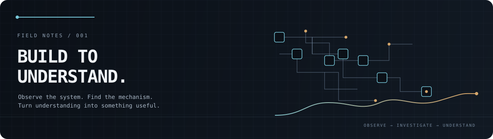

  <h3>(وَقُل رَّبِّ زِدْنِي عِلْمًا)</h3>
  

    <i style="color: #8b949e;">"My Lord! Increase me in knowledge"</i> 
    ◈ Quran: [Taha: 114] ◈
  

### About Me & My Pursuit

I am drawn to what lies beneath the surface—how systems are wired, why they were designed the way they are, and the elegant, foundational ideas that quietly govern complex machines.

Instead of merely operating tools, I seek to take them apart, trace their roots, and uncover the simple principles that make intricate systems possible.

---

### My Laboratory- [bassye.org](https://bassye.org)

I don’t write as someone standing at a podium or looking down from an ivory tower, I write from the floor of my own workshop, guided by curiosity over certainty.

At **[bassye.org](https://bassye.org)**, technology is treated as an open field for trial, error, and honest dismantling. It is my personal laboratory—a place where things are deliberately taken apart to see why they tick, where breaking something is often the only genuine way to understand it, and where confusion is simply the first step of learning.

What you find there are field notes, not lectures. They are the honest remnants of what survived after the dust settled—the dead ends hit, the wrong assumptions corrected, and the quiet epiphanies that only reveal themselves when your hands are deep inside the machinery.

Writing is how I make peace with what I don’t yet know. It forces my wandering thoughts into order, keeps me grounded in humility before the depth of what remains to be learned, and—hopefully—leaves behind an honest, unvarnished trail for the next curious traveler who wanders down the same dark alleys of computing.

  
<b>Technical Arsenal</b>

  

---

> “The most beautiful thing we can experience is the mysterious. It is the source of all true art and science.”
>
> — Albert Einstein, *What I Believe* (1930)
